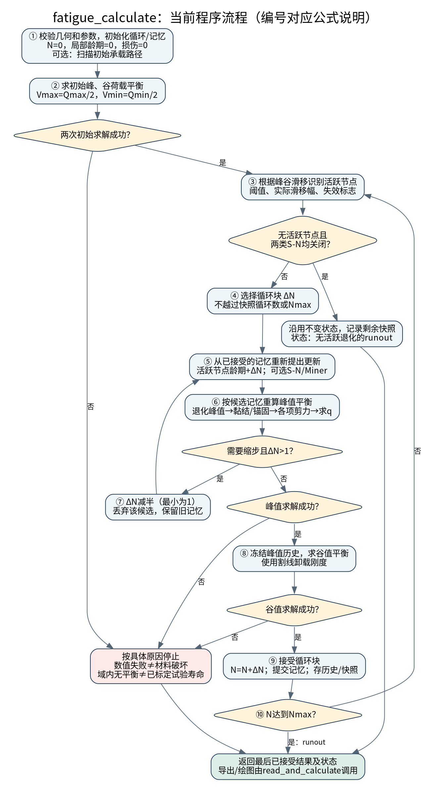

# fatigue_calculate：逐步工作流与公式

本说明核对当前fatigue_calculate及其外部依赖，列出实际执行的关系，不将改编假设称为已验证抗剪疲劳理论。代码本次未修改。

## 符号及试件设置

- N：整梁循环数；n_i：第i个锚固节点激活后的局部龄期；ΔN：一个计算循环块。
- Q：对称四点加载的总力；V：剪跨剪力，V=Q/2。
- q：裂缝两侧竖向相对位移；w：法向张开；v：切向滑移。三者都不是跨中挠度。
- s_i：FRP与混凝土界面滑移；H_i：已达到的最大滑移。
- θ：假定裂缝倾角；α：NSM筋相对梁纵轴的布置角；r=v/w。
- 对用户描述的竖向NSM，应取α=90°。当前parameters.m默认alphaDeg仍为60，需按实际试件设置为90；自定义nsmSegments也须保证筋上下端x相同。以下同时给出一般式和竖筋简式。

## ① 初始化与可选承载扫描

初始化N=0、n_i=0、H_i=0、激活标志A_i=false、单筋失效标志=false、钢筋损伤D_s=0、混凝土损伤D_c=0。

这些是初始条件，不是材料定律。首次求峰值平衡后H_i可增大，但此时记录的N=0表示“首次加载平衡”，不是零荷载。

若computeCapacity=true，cc19_critical沿若干q点扫描初始响应并记录V、Vc、Vs、Vnsm。它是有限域、有限采样的加载路径，不是严格全局承载力求解。

## ② 初始峰谷平衡

外部cc19_state求：

$$V_c(q,D_c)+V_s(q,D_s)+V_f(q,H,n)=V_{target}$$

峰值目标为Qmax/2，谷值目标为Qmin/2。谷值使用峰值历史冻结后的卸载关系。

程序以力残差判断是否满足平衡：

$$|V(q)-V_{target}|\leq\varepsilon_F$$

其中εF=forceTolerance。找根还受maxQ、扫描点数、分支和局部锚固收敛限制；找不到根不应直接解释成已证实的结构极限。

## ③ 识别发生局部疲劳的节点

峰谷界面滑移范围：

$$\Delta s_i=\max(0,s_{i,max}-s_{i,min})$$

对未失效NSM，且Qmax>Qmin，活跃条件为：

$$\chi_i=(A_i^{old}\ \mathrm{OR}\ H_i>\eta\delta_m)\ \mathrm{AND}\ (\Delta s_i>\varepsilon_s)$$

η=activationFraction，论文参考值0.75；εs=cyclicSlipTolerance。A是已经激活过的记忆标志，χ是本步实际计数标志。

75%滑移阈值来自2019抗弯疲劳论文式(2)后的说明；采用历史最大滑移/永久激活标志、额外检查非零峰谷幅，是当前代码的实现补充。由cc19_active执行。

若无活跃节点，且钢筋与混凝土S-N接口都关闭，则程序保留状态不变、直接记录剩余快照，到循环上限返回runout_no_active_degradation。

## ④ 选择循环块

$$\Delta N=\min(\mathrm{cycleStep},N_{max}-N,N_{nextSnapshot}-N)$$

这是数值推进规则，不是疲劳公式。cycleStep不是试验加载频率。

## ⑤ 提出候选记忆与损伤

先复制已接受记忆，候选不会立刻覆盖它。

$$n_i^*=n_i+\chi_i\Delta N,\qquad A_i^*=A_i^{old}\ \mathrm{OR}\ \chi_i$$

只有活跃节点增加局部龄期。随后调用状态求解器时，cc19_strength根据候选龄期重新计算峰值：

$$\tau_{m,i}(n_i^*)=\max\{0,\tau_{m0}[1-k\log_{10}(\max(n_i^*,1))]\}$$

k杆材=0.1965，k条材=0.1985。源于2019抗弯疲劳论文式(2)；max(n_i,1)用于零龄期初始化。把它用于抗剪NSM是移植假设，不是抗剪疲劳试验标定结果。

### 可选钢筋S-N/Miner（默认关闭）

$$\Delta\sigma_{s,j}=\max(0,\sigma_{s,j}^{max}-\sigma_{s,j}^{min})$$

$$N_{f,s,j}=N_{ref,s}(\Delta\sigma_{ref,s}/\Delta\sigma_{s,j})^{m_s}$$

$$D_{s,j}^*=\min(1,D_{s,j}+\Delta N/N_{f,s,j})$$

程序用realmin保护零分母；零应力范围对应无新增疲劳损伤。Nref=Inf表示关闭。这是原代码附加的通用幂律S-N/Miner接口，不是所附2019论文给出的钢筋抗剪疲劳公式。

### 可选混凝土S-N/Miner（默认关闭）

在当前峰谷q区间采样41点，先求每点经验Vc，再计算：

$$\Delta\sigma_c=\frac{\max V_c(q)-\min V_c(q)}{b\,d}$$

$$N_{f,c}=N_{ref,c}(\Delta\sigma_{ref,c}/\Delta\sigma_c)^{m_c},\qquad D_c^*=\min(1,D_c+\Delta N/N_{f,c})$$

这是额外模型选择，不能解释成论文原有的混凝土疲劳定律；不采用简单的峰谷端点Vc之差，而是41点包络的极差。

## ⑥ 根据候选记忆重算峰值状态

这一框最重要，但详细公式在cc19_trial、cc19_hard等外部函数中。

### 6.1 裂缝运动学（沿用原简化假设）

$$g(y)=(1-y/h_c)^m,\quad K=\cos\theta+r\sin\theta$$

$$w_{max}=q/K,\quad v_{max}=r\,w_{max};\qquad w(y)=w_{max}g(y),\quad v(y)=v_{max}g(y)$$

第j根相交NSM的轴向裂缝位移：

$$\delta_j=\max\left(0,qg(y_j)\frac{\sin(\theta+\alpha_j)-r\cos(\theta+\alpha_j)}{K}\right)$$

对竖向NSM，α=90°，上式化为：

$$\boxed{\delta_j=qg(y_j)}$$

以上为当前程序的预设形状和几何投影，不是2019抗剪论文式(7)的完整PST/Green函数张开求解。

### 6.2 黏结包络及卸载

取H为节点最大滑移，τm为退化峰值。当前实现的有效残余为τr,eff=min(τr,τm)，避免退化峰值低于原残余时包络倒挂。

$$\tau_{env}(H)=\begin{cases}\tau_mH/\delta_m,&0\leq H\leq\delta_m\\ \tau_{r,eff}+(\tau_m-\tau_{r,eff})(\delta_u-H)/(\delta_u-\delta_m),&\delta_m<H\leq\delta_u\\ \tau_{r,eff},&H>\delta_u\end{cases}$$

割线刚度ksec=τenv(H)/H；H=0时取τm/δm。当前滑移处的应力为τ=ksec*s。峰值加载时允许H更新为max(Hold,s)，谷值卸载冻结H。它是割线卸载模型，不是完整滞回模型。

三段黏结参考2019抗弯疲劳论文式(1)；有效残余截断是本程序数值补充，不是论文新标定的残余疲劳定律。

### 6.3 两侧锚固平衡

沿每侧从裂缝向自由端取x，当前离散模型对应：

$$\frac{dT}{dx}=-u_f\tau,\qquad\frac{ds}{dx}=-\frac{T}{E_fA_f}$$

$$T_1(0)=T_2(0),\quad s_1(0)+s_2(0)=\delta_j,\quad T_1(L_1)=T_2(L_2)=0$$

uf为筋黏结周长。两侧协调借鉴2019单裂缝抗剪论文式(9d)、(11)；当前FRP轴向变形离散并不等于论文全部体系的逐式实现。

单根筋达到代码的完全锚固脱黏规则、拉力达到Af*ffu或用户保护层限值时，其剪力贡献归零，其他筋和RC部分继续重平衡。残余黏结分段与整根退出不是同一概念。

### 6.4 三项抗剪贡献

FRP：

$$V_f=n_{faces}\sum_j T_j\sin\alpha_j$$

竖向筋：

$$\boxed{V_f=n_{faces}\sum_jT_j}$$

只统计真实穿过裂缝的筋。单面列表已经逐根求和，不再重复乘裂缝高度/间距。

箍筋（当前传递长度闭合假设）：

$$\varepsilon_{s,j}=qg(y_j)/L_t$$

$$\sigma_{s,j}=\begin{cases}\min(E_s\varepsilon_{s,j},f_y),&D_{s,j}<1\\0,&D_{s,j}\geq1\end{cases},\quad V_s=\sum_j A_{s,j}\sigma_{s,j}$$

当前代码在Ds<1时不按(1-Ds)逐渐缩小弹模；达到1后退出。这一点不能自行换成别的损伤本构而仍称保持原算法。

混凝土（原代码经验闭合）：

$$V_c=A_c(1-e^{-q/q_0})[\rho_c+(1-\rho_c)e^{-w_{max}/w_0}](1-D_c)$$

Ac=VcPeak，q0=concreteRiseQ，w0=concreteSofteningW，ρc=concreteResidualRatio。Ac是幅值参数，不保证等于实际曲线峰值。该式不是2019抗剪论文的聚合料黏聚定律或Green积分。

最后重新求根使Vc+Vs+Vf=Qmax/2。剪力分解原则见2022论文式(9)及2024论文式(1)，但上述Vc和运动学闭合仍是当前模型的额外假设。

## ⑦ 判断是否缩小循环块

若峰值求解失败，或新旧q增量超过maxOpeningStep，并且ΔN>1：

$$\Delta N\leftarrow\max(1,\lfloor\Delta N/2\rfloor)$$

回到⑤，从旧的已接受记忆重新提议，不能在被拒绝的候选上叠加损伤。步长已为1时不能再缩小；峰值仍无解则按其状态停止。位移增量阈值是减步控制，不是材料破坏标准。

## ⑧ 冻结峰值历史，求新的谷值平衡

$$V(q_{min},\mathrm{frozen\ peak\ history})=Q_{min}/2$$

采用6.2的割线卸载。成功才进入⑨；失败则返回具体谷值求解状态，不把这个未完成的循环块计入已接受历史。

## ⑨ 接受并保存

$$N\leftarrow N+\Delta N,\quad memory\leftarrow nextMemory$$

同时更新峰谷状态，追加16列历史；到指定snapshotCycles时保存完整场。这里没有新的材料公式。

## ⑩ 继续或停止

- N<Nmax：回到③。
- N达到Nmax：runout_at_Nmax，表示达到本次循环上限，不代表已经确定疲劳寿命。
- 指定q域内无允许平衡、用户压杆/抗弯上限触发时，代码可记录区间[N,N+ΔN]。这是模型停止区间，仍受求根域、分支与闭合假设影响。
- 局部数值不收敛、谷值求解失败、分支分辨率限制应单独报告，不等同材料疲劳破坏。

2019抗弯疲劳论文第2.7节用其式(13)的脱黏长度Ld无解解释失效；本代码的q域平衡判断与它并非同一个方程或已验证的抗剪寿命判据。

## 文献

- Chen, Wang and Cheng (2019), Modeling NSM FRP strengthened RC beams under fatigue due to IC-debonding. DOI: 10.1016/j.ijfatigue.2019.04.039，式(1)/(2)、第2.7/2.8节。
- Chen and Cheng (2019), Single Crack–Based Model for FRP Shear-Strengthened RC Beams. DOI: 10.1061/(ASCE)CC.1943-5614.0000953，式(9d)/(11)；完整式(7)未实现。
- Chen et al. (2022), FRP Shear-Strengthened RC Beams: Re-examining the Shear-Crack Effect. DOI: 10.1061/(ASCE)CC.1943-5614.0001251，式(9a)-(9d)。
- Chen et al. (2024), Shear Resisting Mechanisms of ECC FRP Strengthened RC Beams. DOI: 10.1061/JCCOF2.CCENG-4395，式(1)-(5)为机制参考；当前不是ECC覆盖层模型。
